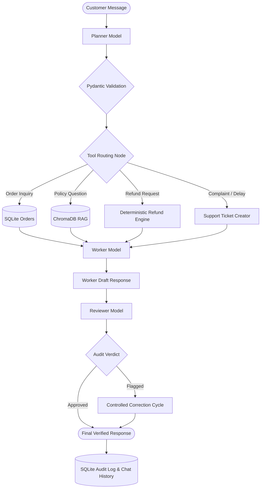

# 🛡️ ResolveAI — Intelligent Customer Care

**Multi-Agent AI & RAG Customer Service Automation and Complaint Resolution System**

ResolveAI is an enterprise-grade customer support platform designed for modern e-commerce companies. Powered by Google Gemini API, LangGraph orchestration, ChromaDB vector search, and SQLite persistent storage, ResolveAI seamlessly automates order tracking, company policy retrieval, complaint management, deterministic refund eligibility checks, and human-in-the-loop supervisor approvals.

---

## 🌟 Key Capabilities

1. **Three Dedicated Gemini AI Model Roles**:
   - 🧠 **PLANNER Model** (`gemini-3.5-flash`): Detects customer intent, identifies missing information (such as Order IDs), determines complaint priority, and generates structured execution plans validated with Pydantic.
   - 🛠️ **WORKER Model** (`gemini-3.5-flash`): Executes the approved workflow plan, queries SQLite for verified order facts, searches policy documents using RAG, enforces deterministic refund rules, and crafts empathetic responses.
   - 🛡️ **REVIEWER Model** (`gemini-3.5-flash`): Independently audits the Worker's response against factual evidence to prevent hallucinations, catch unsupported refund promises, ensure policy compliance, and trigger a bounded 1-cycle correction loop if needed.
2. **Policy Knowledge Base (RAG)**:
   - Chunked and indexed documents: `return_policy.txt`, `refund_policy.txt`, `shipping_policy.txt`, `warranty_policy.txt`, and `faq.txt`.
   - Vector search powered by ChromaDB with Google Gemini embeddings (`gemini-embedding-001`) and a resilient semantic fallback.
3. **Order Investigation & Tracking**:
   - 16 fictional sample orders with diverse statuses: *Processing*, *Shipped*, *In transit*, *Delivered*, *Delayed*, and *Cancelled*.
   - Interactive order timeline, carrier tracking numbers, item breakdown, and instant complaint filing.
4. **Deterministic Refund Rules & Human-in-the-Loop Supervision**:
   - Items under $50 delivered damaged qualify for instant refund without return.
   - Orders in *Processing* or delayed > 14 days qualify for 100% cancellation refunds.
   - High-value refunds ($150+) or missing deliveries ($75+) are placed in **"Awaiting Approval"** status.
   - Supervisor approval dashboard with mandatory rejection justification and PIN authentication (Default PIN: `1234`).
5. **Multi-Channel & Bilingual Support**:
   - Responds fluently in English and understands colloquial Tamil-English (*Tanglish*) inquiries (e.g., *"En order delayed aachu, status enna?"*).
6. **Executive Analytics & Telemetry**:
   - Real-time Plotly charts for complaint categories, ticket statuses, daily trends, and auto-resolution rates.
   - Complete audit trail of every agent step, latency, and model decision in SQLite.

---

## 🏗️ Architecture Diagram



---

## 🛠️ Technology Stack

- **Language**: Python 3.10+ / 3.11+
- **Frontend**: Streamlit with custom CSS design system
- **AI Provider**: Google Gemini API (`google-genai` SDK)
- **Multi-Agent Orchestration**: LangGraph
- **RAG & Vector Database**: ChromaDB (`gemini-embedding-001`)
- **Application Database**: SQLite
- **Validation**: Pydantic v2
- **Data Visualization**: Plotly Express & Graph Objects
- **Testing**: pytest

---

## 🚀 Getting Started on Windows

### 1. Clone or Open Workspace
Open your PowerShell or Terminal in the project root:
```powershell
cd c:\Users\MCA\Documents\rigex
```

### 2. Set Up Virtual Environment (Optional but Recommended)
```powershell
python -m venv venv
.\venv\Scripts\Activate.ps1
```

### 3. Install Dependencies
```powershell
pip install -r requirements.txt
```

### 4. Configure Environment Variables
Copy the sample environment file to `.env`:
```powershell
copy .env.example .env
```
Open `.env` and configure your Google Gemini API key:
```env
GEMINI_API_KEY=your_real_gemini_api_key_here
PLANNER_MODEL=gemini-3.5-flash
WORKER_MODEL=gemini-3.5-flash
REVIEWER_MODEL=gemini-3.5-flash
EMBEDDING_MODEL=gemini-embedding-001
ADMIN_PIN=1234
```
> **Obtaining a Gemini API Key**: Visit [Google AI Studio](https://aistudio.google.com/app/apikey) to generate a free API key.
> *Note: If no API key is configured, ResolveAI runs in a deterministic Demo Mode.*

### 5. Launch ResolveAI
```powershell
streamlit run app.py
```
Open the local URL displayed in the terminal: `http://localhost:8501`.

---

## 🧪 Running Automated Tests

Run the complete test suite with pytest:
```powershell
python -m pytest tests/ -v
```

The automated test suite verifies:
- Database initialization and parameterized order lookups
- Complaint ticket creation and status lifecycle
- Deterministic refund eligibility rules ($50 instant, $150 supervisor approval, processing cancellations)
- Refund approval state transitions and audit logs
- Pydantic schema validation for Planner and Reviewer
- Reviewer rejection of unauthorized or hallucinated worker promises
- RAG semantic policy retrieval and source citations
- End-to-end LangGraph multi-agent workflow execution

---

## 📂 Project Directory Structure

```
rigex/
├── app.py                      # Main Streamlit application entrypoint
├── requirements.txt            # Project dependencies
├── .env.example                # Environment configuration template
├── .env                        # Local environment secrets (git-ignored)
├── .gitignore                  # Git ignore rules
├── README.md                   # Complete documentation
├── config/
│   ├── __init__.py
│   └── settings.py             # Centralized settings & Gemini connection test
├── agents/
│   ├── __init__.py
│   ├── planner.py              # Planner Gemini model (Intent & Tool plan)
│   ├── worker.py               # Worker Gemini model (Fact synthesis)
│   └── reviewer.py             # Reviewer Gemini model (Audit & Safety filter)
├── workflows/
│   ├── __init__.py
│   └── customer_service_graph.py # LangGraph StateGraph orchestration
├── tools/
│   ├── __init__.py
│   ├── order_tools.py          # SQLite order inspection & access validation
│   ├── policy_tools.py         # RAG retriever interface
│   ├── ticket_tools.py         # Support ticket creation & tracking
│   └── refund_tools.py         # Deterministic refund eligibility engine
├── rag/
│   ├── __init__.py
│   ├── ingest.py               # Document chunking & ChromaDB vector ingestion
│   ├── retriever.py            # Semantic retrieval & evidence citation
│   └── policies/
│       ├── return_policy.txt
│       ├── refund_policy.txt
│       ├── shipping_policy.txt
│       ├── warranty_policy.txt
│       └── faq.txt
├── database/
│   ├── __init__.py
│   ├── db.py                   # SQLite tables, queries & transaction safety
│   ├── models.py               # Pydantic data schemas
│   └── seed_data.py            # 16 fictional sample orders & seed records
├── ui/
│   ├── __init__.py
│   ├── styles.py               # Custom CSS design system
│   ├── components.py           # Cards, badges, timeline, chat bubbles
│   └── pages/
│       ├── __init__.py
│       ├── dashboard.py        # Overview dashboard with Plotly charts
│       ├── chat.py             # Interactive AI customer service chat
│       ├── orders.py           # Order tracking and status inspection
│       ├── complaints.py       # Complaint center and ticket history
│       ├── approvals.py        # Refund supervisor approval dashboard
│       ├── knowledge_base.py   # RAG policy viewer & semantic test sandbox
│       ├── agent_monitor.py    # AI Agent Monitor with live execution logs
│       └── analytics.py        # Service analytics & SLA reporting
├── tests/
│   ├── __init__.py
│   ├── test_database.py        # SQLite database operations tests
│   ├── test_refunds.py         # Deterministic refund rules tests
│   ├── test_validation.py      # Schema validation & safety checks tests
│   └── test_workflow.py       # RAG retrieval & LangGraph integration tests
└── data/
    └── .gitkeep
```

---

## 🔒 Security & Reliability

- **No Prompt Injection Execution**: Customer messages and retrieved documents never directly execute SQL, shell commands, or financial transactions.
- **Strict Parameterized Queries**: All SQLite interactions use parameterized queries (`?`) to prevent SQL injection.
- **Bounded Correction Loops**: The Reviewer node permits exactly one controlled correction cycle to eliminate infinite agent loops.
- **Human Financial Authorization**: High-value refund disbursements require authenticated human approval and audit logging.
- **Privacy Masking**: Secret API keys are never rendered in the UI or written to logs.
